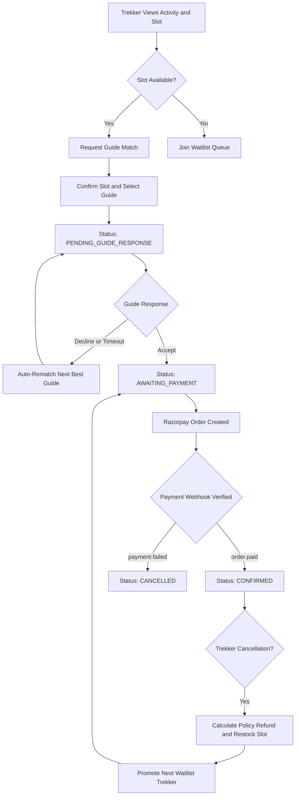
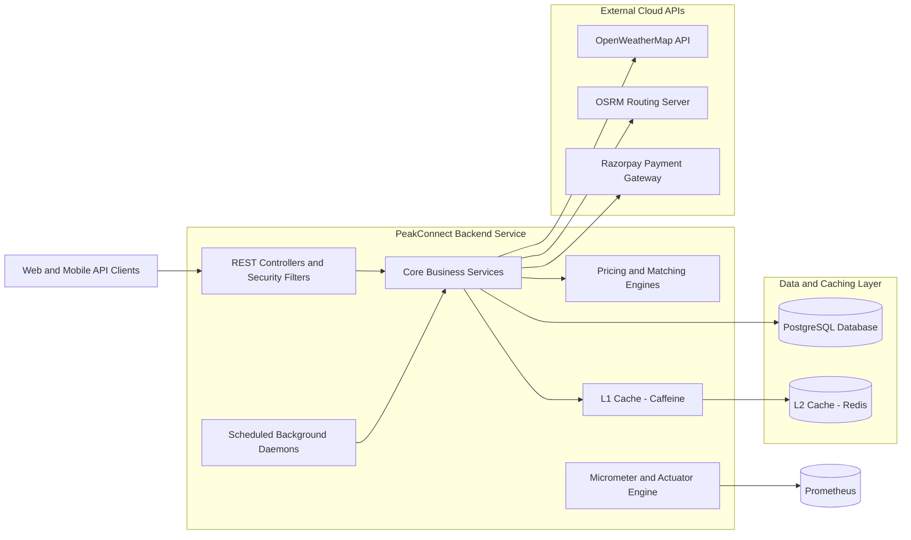

# PeakConnect 🏔️

**An enterprise-grade, concurrency-resilient trekking and adventure activity booking platform built with Spring Boot, Kotlin, and modern distributed architecture.**

[](https://kotlinlang.org/)
[](https://spring.io/projects/spring-boot)
[](https://openjdk.org/)
[](https://www.postgresql.org/)
[](https://redis.io/)
[](https://www.docker.com/)
[](https://peak-connect-backend.onrender.com)
[](#project-status--roadmap)

---

## 📖 About

**PeakConnect** is an adventure activity and trekking expedition booking platform designed to handle complex, high-concurrency reservation workflows in the outdoor tourism space. The system connects adventure seekers (trekkers) with certified mountain guides, pairing live weather hazard assessments and multi-factor dynamic pricing with each available activity slot.

Technically, the project serves as a showcase of robust backend engineering in Kotlin and Spring Boot. It tackles core distributed systems challenges: guaranteeing **zero overselling** under high concurrent load using pessimistic database write locking, executing multi-criteria weighted guide matchmaking, maintaining a two-level cache (L1 in-memory Caffeine + L2 distributed Redis), protecting external API integrations with Resilience4j circuit breakers, and enforcing cryptographic payment webhook verification.

The backend is fully containerized and live on cloud infrastructure (Render Web Service, Neon Serverless PostgreSQL, and Upstash Redis). A native Android application built with Jetpack Compose is planned as the frontend phase.

> 📚 **Detailed Documentation**: Comprehensive architecture notes, task logs, and local observability configurations are preserved in [README_V2.md](backend/README_V2.md).

---

## ✨ Key Features

### 🥾 Trekker Features
- **Dynamic Slot Pricing**: Prices adjust automatically based on season, advance booking lead time, current slot occupancy, and recent view velocity.
- **Real-Time Weather Risk Scoring**: Each slot calculates an automated risk score (`LOW`, `MODERATE`, `HIGH`) derived from OpenWeatherMap forecasts.
- **Ranked Guide Matchmaking**: Trekkers receive a multi-criteria ranked recommendation of verified mountain guides based on skill fit, driving distance (OSRM), and spoken languages.
- **Concurrency-Safe Reservations**: Guaranteed seat isolation ensuring no slot is ever double-booked or over-reserved.
- **Automated Waitlist Queue**: When a slot reaches maximum capacity, trekkers can join a FIFO waitlist. If a cancellation occurs, the top waitlisted trekker receives an exclusive 30-minute priority reservation window.
- **Self-Service Cancellation & Automated Refunds**: Trekkers can cancel bookings with tiered refund percentages computed automatically according to activity cancellation policies (`FLEXIBLE`, `MODERATE`, `STRICT`).

### 🧗 Guide Features
- **Profile & Credential Management**: Guides specify outdoor technical skills, spoken languages, location, GPS coordinates, and experience level.
- **Actionable Booking Dispatch**: Guides view pending booking assignments with an actionable status funnel.
- **Acceptance & Automated Rematch**: Guides can accept or decline assignments. Declining an assignment automatically excludes that guide and triggers an auto-rematch to the next best candidate.
- **Response Timeout Watchdog**: An automated background job sweeps bookings exceeding the 20-minute response window and auto-reassigns them to alternate guides.
- **No-Show Reporting**: Verified guides can mark confirmed bookings as no-show following the activity departure date.

### 🛡️ Admin Features
- **Activity & Slot Management**: Complete administrative control over activities, coordinates, base pricing, cancellation tiers, and departure slots.
- **Guide Verification Workflow**: Verification queue enabling administrators to inspect guide credentials and approve or reject guide accounts.
- **Real-Time Aggregate Analytics**: Dedicated administrative endpoints reporting daily bookings volume, L1/L2 cache hit/miss performance, active waitlist queues, and guide response turnaround times.

---

## 🔄 How It Works

The booking lifecycle coordinates dynamic pricing, weather risk checks, guide dispatch, pessimistic lock acquisition, payment gateway order generation, and webhook settlement:



---

## 🏗️ Architecture & Design Highlights

PeakConnect is architected around resilient domain modeling, clear separation of concerns, and robust data integrity:

- **Strategy Pattern for Pricing**: `PriceCalculator` coordinates independent implementations of `PricingStrategy` (`SeasonStrategy`, `LeadTimeStrategy`, `OccupancyStrategy`, `DemandStrategy`) without coupling calculation rules.
- **Multi-Factor Weighted Guide Matcher**: `HybridMatcher` evaluates `SkillBasedMatcher`, `LocationMatcher` (integrating real road network distances via OSRM), and `LanguageMatcher` with configurable weights to calculate guide compatibility scores (0.0–1.0).
- **Concurrency Safety via Pessimistic Write Locks**: `confirmBooking` acquires an explicit JPA `@Lock(LockModeType.PESSIMISTIC_WRITE)` (`SELECT ... FOR UPDATE` in PostgreSQL) on the target slot row, paired with an enforced database table constraint `CHECK (current_occupancy <= capacity)`. This mathematically eliminates race conditions and overselling under load.
- **Two-Level Cache (L1 Caffeine + L2 Redis)**: Custom `TwoLevelCacheManager` serves hot reads from local in-memory Caffeine cache (30s TTL) to bypass network serialization, backed by distributed Redis (`priceCache` 5m TTL, `riskCache` 15m TTL, `guideAvailabilityCache` 2m TTL) with graceful fallback to cache misses upon schema evolutions.
- **Fault-Tolerant Circuit Breakers & Retries**: Resilience4j annotations wrap all external integrations (OpenWeatherMap, OSRM, Razorpay). When third-party providers degrade, circuit breakers switch states to trigger cached fallbacks, protecting system availability.
- **Autonomous Background Daemons**: Spring `@Scheduled` worker jobs manage proactive weather forecast cache warming, unpaid booking timeouts (15 minutes), waitlist reservation expirations (30 minutes), and guide response timeouts (20 minutes).
- **Cryptographic Webhook Signature Verification**: Incoming payment notifications to `/api/payments/webhook` are cryptographically verified using HMAC-SHA256 digests over raw payload bytes, ensuring only authentic payment events update booking states.



---

## 💻 Tech Stack

| Category | Technology | Purpose |
| :--- | :--- | :--- |
| **Backend Framework** | Kotlin 1.9, Spring Boot 3.3.1 | Core REST API, dependency injection, and business logic |
| **Persistence** | Spring Data JPA, Hibernate 6 | ORM, entity management, and repository abstraction |
| **Database** | PostgreSQL 14+ | Relational data store with ACID transactional constraints |
| **Local / L1 Caching** | Caffeine Cache | Sub-millisecond in-memory cache for ultra-hot read paths |
| **Distributed / L2 Caching** | Redis 7+ (Lettuce Driver) | Distributed multi-instance cache and real-time view counters |
| **Security** | Spring Security 6, JJWT 0.12 | Stateless JWT authentication, role-based authorization (RBAC) |
| **Fault Tolerance** | Resilience4j | Circuit breakers, retry mechanisms, and graceful fallbacks |
| **Observability** | Micrometer, Prometheus, Grafana | Custom metrics, endpoint latency timers, and pre-built dashboards |
| **Load Testing** | Grafana k6 (v2.3+) | Automated concurrency stress testing and threshold assertions |
| **Containerization** | Docker, Multi-Stage Build | Minimal 138MB runtime image based on Eclipse Temurin JRE 17 Alpine |
| **Cloud Deployment** | Render, Neon Postgres, Upstash Redis | Live cloud hosting with TLS-enabled serverless databases |
| **External APIs** | OpenWeatherMap, OSRM, Razorpay | Weather risk assessment, road routing, and payment processing |
| **Mobile Frontend** *(Planned)* | Android, Kotlin, Jetpack Compose | Native Android application (Phase V2 Part 2) |

---

## ⚡ Performance & Reliability

To rigorously stress-test the double-booking prevention constraint under extreme race conditions, an automated **k6 load test** was executed against the booking endpoint.

### Concurrency Stress Test Summary
- **Scenario**: 20 concurrent virtual users (VUs) executed full booking funnels across 3 stages (20s ramp-up, 40s sustained hold, 10s ramp-down) over 70 seconds.
- **Constraint Tested**: A slot seeded with a strictly limited capacity of **5 spots** competing against 20 concurrent users making 2,059 booking requests (6,178 total HTTP requests).
- **Correctness Assertion**: Total successful bookings must never exceed slot capacity (`successful_bookings <= 5`).

```
  █ THRESHOLDS 

    booking_confirm_duration.......: ✓ 'p(95)<1000' p(95)=20.9ms
    http_req_duration..............: ✓ 'p(95)<1000' p(95)=19.35ms
    successful_bookings............: ✓ 'count<=5'   count=5
    error_rate.....................: ✓ 'rate<0.01'  rate=0.00%
    unexpected_errors..............: ✓ 'count==0'   count=0

  █ TOTAL RESULTS 

    checks_succeeded...............: 100.00% (6,177 out of 6,177)
    successful_bookings............: 5
    slot_full_bookings (HTTP 409)..: 2,054
    unexpected_errors (5xx)........: 0
```

- **Outcome**: **PASS**. Exactly 5 bookings were created in PostgreSQL matching the capacity limit. All 2,054 excess requests were cleanly rejected with HTTP 409 Conflict without deadlocks, database corruption, or 5xx server errors.
- **Detailed Report**: Full methodology, raw logs, and SQL audit tables are documented in [load-test/RESULTS.md](backend/load-test/RESULTS.md).

---

## 🗺️ Project Status / Roadmap

### ✅ Completed: V1 MVP & V2 Part 1 Backend
- [x] Stateless JWT authentication and role-based authorization (`TREKKER`, `GUIDE`, `ADMIN`).
- [x] Activity discovery and scheduling slot management.
- [x] Multi-criteria dynamic pricing engine (Season, Lead Time, Occupancy, Demand).
- [x] Real-time OpenWeatherMap risk assessment engine.
- [x] Two-level caching architecture (L1 Caffeine + L2 Redis) with serialized JSON storage.
- [x] Weighted guide matching with OSRM driving distance routing.
- [x] Actionable guide dispatch (Accept / Decline) with automated re-match on decline.
- [x] Time-boxed FIFO waitlist queue with priority promotion.
- [x] Tiered cancellation policy engine (Flexible, Moderate, Strict) with automated refund calculation.
- [x] Razorpay payment integration and HMAC-SHA256 webhook signature verification.
- [x] Resilience4j circuit breakers and retries with degraded mode fallbacks.
- [x] Automated background worker jobs for cache refresh, payment timeouts, and waitlists.
- [x] Local observability stack (Prometheus scraping + provisioned Grafana dashboards).
- [x] Concurrency load testing suite with k6 verifying pessimistic write locking.
- [x] Multi-stage Docker containerization and live deployment to Render, Neon, and Upstash.

### ⏳ Upcoming: V2 Part 2 Android Frontend *(Planned)*
- [ ] Native Android client in Kotlin with Jetpack Compose UI.
- [ ] Trekker activity browsing with real-time pricing and weather risk badge displays.
- [ ] Interactive guide selection and ranked recommendation cards.
- [ ] Razorpay Android Checkout SDK integration (payment sheet).
- [ ] Firebase Cloud Messaging (FCM) push notifications for guide re-match and waitlist alerts.
- [ ] Guide dashboard for instant booking acceptance, decline, and assignment tracking.
- [ ] Admin metrics dashboard visualizing operational statistics.

---

## 🌐 Live Demo

The PeakConnect V2 backend is live and publicly accessible:
- **Base URL**: `https://peak-connect-backend.onrender.com`
- **Health Check Endpoint**: [https://peak-connect-backend.onrender.com/actuator/health](https://peak-connect-backend.onrender.com/actuator/health)

> [!NOTE]
> The service is hosted on Render's Free tier, which automatically spins down the container after 15 minutes of inactivity. If the service is asleep, the first request may experience a **45–60 second cold start** while the container and database compute wake up. Subsequent requests respond with sub-50ms latency.

---

## 🚀 Getting Started (Local Development)

### Prerequisites
- **JDK 17** or higher
- **Maven 3.9+**
- **Docker** and **Docker Compose**

### 1. Clone the Repository
```bash
git clone https://github.com/YadavKshitiz/peak-connect_backend.git
cd peak-connect_backend/backend
```

### 2. Configure Environment Variables
Copy the template environment file:
```bash
cp .env.example .env
```
Open `.env` and fill in your local or test credentials. The required variable names are:
- `PORT`
- `SPRING_PROFILES_ACTIVE`
- `DB_URL`, `DB_USERNAME`, `DB_PASSWORD`
- `JWT_SECRET`
- `REDIS_HOST`, `REDIS_PORT`, `REDIS_PASSWORD`, `REDIS_SSL`
- `OPENWEATHER_API_KEY`
- `OSRM_BASE_URL`
- `RAZORPAY_KEY_ID`, `RAZORPAY_KEY_SECRET`

### 3. Start Infrastructure Services
Start PostgreSQL, Redis, Prometheus, and Grafana via Docker Compose:
```bash
docker compose up -d
```
Verify services are running:
- PostgreSQL: `localhost:5432`
- Redis: `localhost:6379`
- Prometheus: [http://localhost:9090](http://localhost:9090)
- Grafana: [http://localhost:3000](http://localhost:3000) (Credentials: `admin` / `admin`)

### 4. Run the Application
```bash
mvn spring-boot:run
```
Once initialized, test application health:
```bash
curl http://localhost:8080/actuator/health
```

---

## 📡 API Overview

| Group | Method | Path | Description | Access |
| :--- | :--- | :--- | :--- | :--- |
| **Auth** | `POST` | `/api/auth/register` | Register a new Trekker or Guide account | Public |
| **Auth** | `POST` | `/api/auth/login` | Authenticate credentials and receive JWT | Public |
| **Activities** | `GET` | `/api/activities` | Browse activities with optional location/date filter | Authenticated |
| **Activities** | `GET` | `/api/activities/{id}` | View activity details, slots, dynamic price & weather risk | Authenticated |
| **Bookings** | `POST` | `/api/bookings/request` | Request ranked guide matches for a slot | Trekker |
| **Bookings** | `POST` | `/api/bookings/confirm` | Confirm slot reservation and assign initial guide | Trekker |
| **Bookings** | `GET` | `/api/bookings/my` | View current user's booking history | Trekker |
| **Bookings** | `POST` | `/api/bookings/{id}/cancel` | Cancel booking with automated policy refund calculation | Trekker |
| **Bookings** | `POST` | `/api/bookings/waitlist` | Join FIFO waitlist queue when slot capacity is full | Trekker |
| **Guides** | `GET` | `/api/guides/me` | Fetch authenticated guide profile | Guide |
| **Guides** | `PUT` | `/api/guides/me` | Update guide skills, languages, location, and coordinates | Guide |
| **Guides** | `GET` | `/api/guides/me/bookings` | View bookings assigned to the authenticated guide | Guide |
| **Guides** | `POST` | `/api/bookings/{id}/accept` | Guide accepts assigned booking, creating Razorpay deposit order | Guide |
| **Guides** | `POST` | `/api/bookings/{id}/decline` | Guide declines booking, triggering auto-rematch to next guide | Guide |
| **Guides** | `POST` | `/api/bookings/{id}/no-show` | Mark confirmed booking as no-show following activity date | Guide |
| **Admin** | `POST` | `/api/admin/activities` | Create a new adventure activity | Admin |
| **Admin** | `POST` | `/api/admin/activities/{id}/slots` | Create a departure slot with capacity and season | Admin |
| **Admin** | `GET` | `/api/admin/guides` | List pending and verified guide applications | Admin |
| **Admin** | `POST` | `/api/admin/guides/{id}/approve` | Verify and approve a guide profile | Admin |
| **Admin Stats** | `GET` | `/api/admin/stats/bookings-today` | Get count of bookings created and confirmed today | Admin |
| **Admin Stats** | `GET` | `/api/admin/stats/cache-hit-rate` | Retrieve L1/L2 cache request counts and hit ratios | Admin |
| **Admin Stats** | `GET` | `/api/admin/stats/waitlists` | View active waitlist queues broken down by slot | Admin |
| **Admin Stats** | `GET` | `/api/admin/stats/guide-responses` | Retrieve guide accept/decline turnaround metrics | Admin |
| **Payments** | `POST` | `/api/payments/webhook` | Process Razorpay payment notifications (`order.paid`, `payment.failed`) | Webhook (Signed) |
| **Actuator** | `GET` | `/actuator/health` | Service health status including DB and Redis readiness | Public |

---

## ⚠️ Known Limitations

- **Render Free Sleep Cycle**: Instances sleep after 15 minutes of inactivity; the initial request after sleep takes 45–60 seconds while compute awakens.
- **Scheduled Job Execution**: Background daemons (`WeatherRefreshJob`, `AutoCancelUnpaidBookingsJob`, `WaitlistExpiryJob`, `GuideResponseTimeoutJob`) run only while the instance is awake and catch up immediately on the first tick upon waking.
- **Free-Tier Ephemeral Data**: Neon PostgreSQL and Upstash Redis free tiers have strict quota bounds (0.5 GiB storage and 10,000 requests/day). Idle branches may suspend, so cloud demo data should be treated as ephemeral.
- **Public OSRM Demo Server**: Routing distances are computed via the public OSRM demonstration server (`router.project-osrm.org`), which is unauthenticated and intended strictly for light demonstration traffic; high request volumes will be rate-limited.
- **Open Registration for Roles**: In the current version, `/api/auth/register` allows self-registration for `TREKKER` and `GUIDE` (with `ADMIN` rejected). Production deployments should restrict guide onboarding behind administrative invite tokens.

---

## 👤 Author

- **Name**: Kshitiz Yadav
- **GitHub**: [YadavKshitiz](https://github.com/YadavKshitiz)
- **LinkedIn**: [yadavkshitiz94/](https://linkedin.com/in/)

---

## 📄 License

This project is licensed under the [MIT License](LICENSE).
