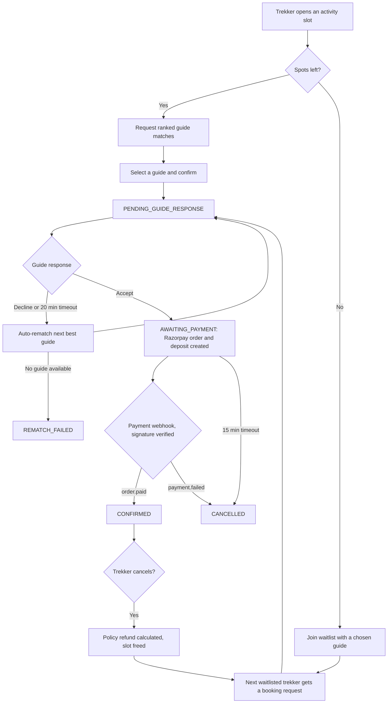
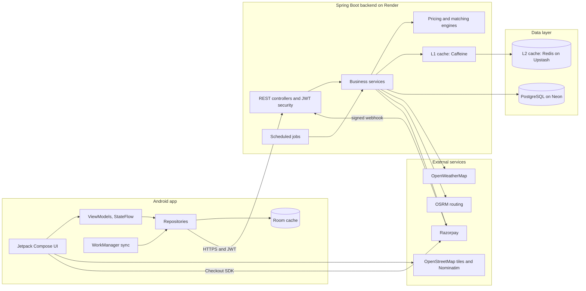
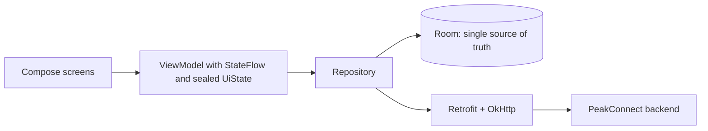

# PeakConnect 🏔️

**A full-stack trekking and adventure booking platform: a concurrency-safe Spring Boot (Kotlin) backend and a native Android app built with Jetpack Compose.**

[](https://kotlinlang.org/)
[](https://spring.io/projects/spring-boot)
[](https://developer.android.com/jetpack/compose)
[](#-android-app-architecture)
[](https://neon.tech/)
[](https://upstash.com/)
[](https://www.docker.com/)
[](https://peak-connect-backend.onrender.com)
[](#-project-status)

---

## 📖 About

**PeakConnect** connects adventure seekers (trekkers) with verified mountain guides. Every activity slot comes with a live, dynamically computed price and a weather-based risk score, and bookings go through a guide-approval and payment flow.

The project has two halves that live in this repository:

| Part | Folder | What it is |
| :--- | :--- | :--- |
| **Backend** | [`backend/`](backend/) | Spring Boot 3 + Kotlin REST API, deployed on the cloud |
| **Android app** | [`frontend/`](frontend/) | Native Kotlin and Jetpack Compose app for Trekkers and Guides |

The backend solves hard reservation problems: **zero overselling under heavy concurrent load** (pessimistic locking plus a database constraint), weighted guide matchmaking, a two-level cache, circuit-breaker-protected external APIs, and cryptographically verified payment webhooks. The Android app puts a complete product on top of it: browsing, booking, payment, waitlist, a guide workspace, offline reading, notifications and Hindi support.

> 📚 More documentation: [`backend/README_V2.md`](backend/README_V2.md) (backend task log and observability), [`frontend/README.md`](frontend/README.md) (app details), and [`frontend/docs/`](frontend/docs/) (API contract, design system, demo script).

---

## 📲 Try the App

A ready-to-install release build is in this repository:

**➡️ [`PeakConnect.apk`](PeakConnect.apk)** ([direct download](https://github.com/YadavKshitiz/peak-connect_backend/raw/main/PeakConnect.apk))

1. Download the APK on an Android phone (Android 8.0 / API 26 or newer).
2. Allow "Install unknown apps" for the app you opened it from (Chrome, Files and so on). Android may show a Play Protect warning, which is normal for an APK that is not from the Play Store.
3. Open the app. The backend runs on a free tier, so the **first launch can take 30 to 60 seconds** while the server wakes up. The app shows a "Waking up the server" screen and continues by itself.
4. Register as a **Trekker** and explore. To try the guide side, register a second account as a **Guide**. Guides must be approved by an admin first (see [Admin operations](#️-admin-operations)).

> 💳 **Payments run in Razorpay test mode. No real money is ever charged.** At checkout use UPI `success@razorpay`, or Razorpay's domestic test card `5267 3181 8797 5449` with any future expiry and any CVV. If a one-time password is asked, enter any 4 to 10 digit number. Check [Razorpay's test card page](https://razorpay.com/docs/payments/payments/test-cards) if these ever change.

### Screenshots

<!-- Add your screenshots to frontend/docs/screenshots/ and replace this line with a table of images, for example:
| Explore | Activity detail | Guide matches | Booking status |
| :---: | :---: | :---: | :---: |
|  |  |  |  |
-->
_Screenshots coming soon._

---

## ✨ Features

### 🥾 Trekkers
- **Explore** activities in a paged grid with search, filters (difficulty, location, date) and sorting, all working offline from cached data.
- **Live price and risk on every slot**: the price adapts to season, lead time, occupancy and demand, and a weather risk badge (`LOW`, `MODERATE`, `HIGH`) comes from OpenWeatherMap.
- **Ranked guide matching** by skills and distance, with sliders to choose what matters most.
- **Booking with guide approval, then deposit payment** (Razorpay), with a live status timeline.
- **Cancellation** with a refund preview and the server's final refund amounts.
- **Waitlist** for full slots: pick a guide, and a booking request is created automatically when a spot opens.
- Favourites, recently viewed, a per-activity **packing checklist**, share sheet, directions to the trailhead, and **Trek safety tips** with a tap-to-dial emergency number.

### 🧗 Guides
- **Guide home** with verification status, request counts and pending requests with response countdowns.
- **Accept or decline** booking requests, and **mark no-shows** after the activity date.
- **Profile editor** with skills, languages, experience level and a **map picker** (OpenStreetMap with place search and "use my location").
- Declining a request automatically re-matches the trekker with the next best guide.

### 📱 App-wide
- **Smart cold-start handling**: a friendly wake-up screen with elapsed time when the free server is asleep.
- **Offline read-only mode**: cached activities, bookings and profiles stay visible. Every action that needs the network is disabled with a clear message.
- **Local notifications and in-app inbox** for booking updates and reminders.
- Light and dark themes, **English and Hindi**, accessibility pass (48dp touch targets, large font support, colour-independent status).

### 🛡️ Admin (API only, no app screens)
- Create and manage activities and departure slots.
- Verify or reject guides.
- Aggregate statistics endpoints (bookings today, cache hit rate, waitlists, guide response times).

---

## 🔄 How a Booking Works



Statuses used by the app and the API: `PENDING_GUIDE_RESPONSE`, `AWAITING_PAYMENT`, `CONFIRMED`, `CANCELLED`, `NO_SHOW`, `REMATCH_FAILED` (and a legacy `PENDING`). The payment result is trusted **only** from the backend webhook. The app never marks a booking as paid by itself.

---

## 🏗️ System Architecture



### Backend design highlights
- **Strategy pattern for pricing**: `PriceCalculator` composes independent `PricingStrategy` classes (`SeasonStrategy`, `LeadTimeStrategy`, `OccupancyStrategy`, `DemandStrategy`). New rules are new classes, with no existing code changed.
- **Weighted guide matcher**: `HybridMatcher` combines `SkillBasedMatcher`, `LocationMatcher` (real road distance from OSRM) and `LanguageMatcher` with request-time weights.
- **Overselling prevention**: `confirmBooking` takes a `PESSIMISTIC_WRITE` lock on the slot row (`SELECT ... FOR UPDATE`) and a database `CHECK (current_occupancy <= capacity)` constraint backs it up.
- **Two-level cache**: Caffeine (30s) in front of Redis (price 5m, risk 15m, guide availability 2m).
- **Resilience4j** circuit breakers, retries and fallbacks around OpenWeatherMap, OSRM and Razorpay, so a failing provider degrades gracefully.
- **Scheduled jobs**: weather refresh, unpaid-booking timeout (15 min), waitlist expiry, guide-response timeout (20 min).
- **Webhook security**: HMAC-SHA256 signature verification over the raw payload.
- **Observability**: Micrometer metrics, Prometheus and provisioned Grafana dashboards.

### 📱 Android app architecture

- **Single activity, MVVM, unidirectional data flow**, Hilt for dependency injection, feature-based packages.
- **Room is the single source of truth.** Screens read only from the database, and network refreshes write into it, so the app works offline and never loses its cache on a failed request.
- **Security**: the JWT is stored in DataStore encrypted with an Android Keystore AES-GCM key, and the app never contains a payment secret (Razorpay secrets stay on the server).
- **Images**: the backend has no image field, so activity pictures come from a `manifest.json` in this repo's `assets/` folder and fall back to a clean placeholder when missing.

---

## 💻 Tech Stack

| Layer | Technology |
| :--- | :--- |
| **Backend** | Kotlin 1.9, Spring Boot 3.3.1, Spring Data JPA / Hibernate 6, Spring Security 6 with JWT |
| **Data** | PostgreSQL (Neon), Redis (Upstash), Caffeine |
| **Resilience & ops** | Resilience4j, Micrometer, Prometheus, Grafana, Docker (multi-stage), Render |
| **Load testing** | Grafana k6 |
| **External APIs** | OpenWeatherMap, OSRM, Razorpay |
| **Android UI** | Kotlin, Jetpack Compose, Material 3, Navigation Compose (type-safe routes) |
| **Android architecture** | MVVM, StateFlow, Hilt, kotlinx.serialization |
| **Android data** | Retrofit, OkHttp, Room, Paging 3, DataStore |
| **Android features** | Coil 3 (images), WorkManager (sync and reminders), osmdroid (OpenStreetMap), Razorpay Checkout SDK |
| **Android build** | minSdk 26, compile and target SDK 37, R8 shrinking in release builds |
| **Testing** | JUnit, MockK, Turbine, MockWebServer, Robolectric, Compose UI tests (300 unit tests passing) |

---

## ⚡ Performance and Reliability

A **k6 load test** hit the booking endpoint with 20 concurrent virtual users competing for a slot with only **5 spots**:

```
  booking_confirm_duration.......: ✓ p(95)=20.9ms   (threshold < 1000ms)
  http_req_duration..............: ✓ p(95)=19.35ms
  successful_bookings............: ✓ 5              (never more than capacity)
  slot_full_bookings (HTTP 409)..: 2,054
  unexpected_errors (5xx)........: ✓ 0
```

Exactly 5 bookings were created. The other 2,054 requests were rejected cleanly with `409 Conflict`, with no deadlocks, no corrupt data and no server errors. Details are in [`backend/load-test/RESULTS.md`](backend/load-test/RESULTS.md).

---

## 🌐 Live Backend

- **Base URL**: `https://peak-connect-backend.onrender.com`
- **Health**: <https://peak-connect-backend.onrender.com/actuator/health>

> [!NOTE]
> The backend is on Render's free tier and **sleeps after 15 minutes without traffic**. The first request afterwards can take 45 to 60 seconds. The Android app handles this with its wake-up screen. When demoing, open the app once beforehand.

---

## 🚀 Getting Started

### Run the backend locally

Prerequisites: **JDK 17+**, **Maven 3.9+**, **Docker** and **Docker Compose**.

```bash
git clone https://github.com/YadavKshitiz/peak-connect_backend.git
cd peak-connect_backend/backend
cp .env.example .env        # then fill in your own values
docker compose up -d        # PostgreSQL, Redis, Prometheus, Grafana
set -a && source .env && set +a
mvn spring-boot:run
curl http://localhost:8080/actuator/health
```

Required variables (names only): `PORT`, `SPRING_PROFILES_ACTIVE`, `DB_URL`, `DB_USERNAME`, `DB_PASSWORD`, `JWT_SECRET`, `REDIS_HOST`, `REDIS_PORT`, `REDIS_PASSWORD`, `REDIS_SSL`, `OPENWEATHER_API_KEY`, `OSRM_BASE_URL`, `RAZORPAY_KEY_ID`, `RAZORPAY_KEY_SECRET`. Use Razorpay **test** keys.

### Build the Android app

Prerequisites: the latest stable **Android Studio** (it bundles JDK 17+) and the Android SDK Platform it recommends.

```bash
cd peak-connect_backend/frontend
cp local.properties.example local.properties
```

Edit `frontend/local.properties` (this file is git-ignored, so never commit it):

```properties
RAZORPAY_KEY_ID=rzp_test_xxxxxxxxxxxx     # the same test account the backend uses
API_BASE_URL=https://peak-connect-backend.onrender.com/
```

Open the `frontend` folder in Android Studio, let Gradle sync, and run the app on a device or emulator. Command-line equivalents:

```bash
./gradlew assembleDebug testDebugUnitTest lint
./gradlew assembleRelease
```

To point the app at a backend running on your own computer, set `API_BASE_URL=http://10.0.2.2:8080/` for the Android emulator (debug builds allow cleartext HTTP to `10.0.2.2` and `localhost` only).

### Activity images

Pictures live in `assets/activity_images/` on the `main` branch and are matched by name:

```
assets/activity_images/
  manifest.json
  <location-slug>/<activity-slug>.webp     e.g. manali/hampta-pass-trek.webp
```

The slug is the lowercase text with non-alphanumeric characters turned into hyphens (for example "McLeod Ganj" becomes `mcleod-ganj`). Each image needs a line in `manifest.json`. The app downloads the manifest in the background, caches it, and shows a gradient placeholder with "Image unavailable" for anything missing. See [`frontend/README.md`](frontend/README.md) for the file format.

---

## 🛠️ Admin Operations

There is no admin screen in the app. Admin tasks use the API, and the commands below work from any terminal with `curl` and `python3`. An account cannot register itself as `ADMIN` (the API rejects it). To create one, register a normal account and change its role directly in the database, for example `UPDATE users SET role = 'ADMIN' WHERE email = '<your email>';`.

```bash
API=https://peak-connect-backend.onrender.com
read -s -p "Admin password: " ADMIN_PW; echo
ADMIN_TOKEN=$(curl -s --max-time 90 -X POST $API/api/auth/login \
  -H "Content-Type: application/json" \
  -d "{\"email\":\"YOUR_ADMIN_EMAIL\",\"password\":\"$ADMIN_PW\"}" \
  | python3 -c "import sys,json;print(json.load(sys.stdin)['token'])")
```

**Approve guides**
```bash
# list guides waiting for approval
curl -s "$API/api/admin/guides?isVerified=false" -H "Authorization: Bearer $ADMIN_TOKEN"
# approve one (or POST .../reject)
curl -s -X POST $API/api/admin/guides/<GUIDE_ID>/approve -H "Authorization: Bearer $ADMIN_TOKEN"
```

**Add an activity and a slot**
```bash
curl -s -X POST $API/api/admin/activities \
  -H "Authorization: Bearer $ADMIN_TOKEN" -H "Content-Type: application/json" \
  -d '{"title":"Triund Sunset Trek","description":"Sunset views over the Dhauladhar range.",
       "location":"McLeod Ganj","latitude":32.2426,"longitude":76.3213,
       "difficultyLevel":"EASY","basePrice":2500,"cancellationPolicy":"FLEXIBLE"}'

curl -s -X POST $API/api/admin/activities/<ACTIVITY_ID>/slots \
  -H "Authorization: Bearer $ADMIN_TOKEN" -H "Content-Type: application/json" \
  -d '{"date":"2027-01-10T06:00:00","capacity":12,"season":"LOW"}'
```

Allowed values: `difficultyLevel` is `EASY`, `MODERATE`, `CHALLENGING` or `EXTREME`. `cancellationPolicy` is `FLEXIBLE`, `MODERATE` or `STRICT`. `season` is `LOW`, `SHOULDER` or `PEAK`. A slot needs a future date to be bookable.

**Seed demo data:** [`add_activities.sh`](add_activities.sh) creates 10 sample activities with slots. It asks for the admin login and skips activities that already exist: `bash add_activities.sh`.

A guide appears in matches only when they are **approved** and their profile (skills, languages, location with coordinates, experience level) is filled in.

---

## 📡 API Overview

| Group | Method | Path | Description | Access |
| :--- | :--- | :--- | :--- | :--- |
| **Auth** | `POST` | `/api/auth/register` | Register a Trekker or Guide (Admin is rejected) | Public |
| **Auth** | `POST` | `/api/auth/login` | Log in and receive a JWT (valid 24 hours) | Public |
| **Activities** | `GET` | `/api/activities` | List activities with their slots, live price and risk | Public |
| **Activities** | `GET` | `/api/activities/{id}` | Activity details with slots | Public |
| **Bookings** | `POST` | `/api/bookings/request` | Ranked guide matches for a slot | Trekker |
| **Bookings** | `POST` | `/api/bookings/confirm` | Reserve a slot with a chosen guide | Trekker |
| **Bookings** | `GET` | `/api/bookings/my` | The trekker's bookings | Trekker |
| **Bookings** | `POST` | `/api/bookings/{id}/cancel` | Cancel with policy-based refund | Trekker |
| **Bookings** | `POST` | `/api/bookings/waitlist` | Join the waitlist of a full slot with a chosen guide | Trekker |
| **Guides** | `GET` / `PUT` | `/api/guides/me` | Read or update the guide profile | Guide |
| **Guides** | `GET` | `/api/guides/me/bookings` | Bookings assigned to the guide | Guide |
| **Guides** | `POST` | `/api/bookings/{id}/accept` | Accept a booking (creates the Razorpay deposit order) | Guide |
| **Guides** | `POST` | `/api/bookings/{id}/decline` | Decline, triggers auto-rematch | Guide |
| **Guides** | `POST` | `/api/bookings/{id}/no-show` | Mark a confirmed booking as no-show | Guide |
| **Admin** | `POST` `GET` `PUT` `DELETE` | `/api/admin/activities` and `/{id}` | Manage activities | Admin |
| **Admin** | `POST` `GET` `PUT` `DELETE` | `/api/admin/activities/{id}/slots` and `/{slotId}` | Manage slots | Admin |
| **Admin** | `GET` | `/api/admin/guides?isVerified=` | List guides | Admin |
| **Admin** | `POST` | `/api/admin/guides/{id}/approve` and `/reject` | Verify or reject a guide | Admin |
| **Admin stats** | `GET` | `/api/admin/stats/*` | Bookings today, cache hit rate, waitlists, guide responses | Admin |
| **Payments** | `POST` | `/api/payments/webhook` | Razorpay `order.paid` and `payment.failed` events | Signed webhook |
| **Ops** | `GET` | `/actuator/health` | Health including database and Redis | Public |

The Android app's exact request and response shapes are documented in [`frontend/docs/API_CONTRACT.md`](frontend/docs/API_CONTRACT.md).

---

## 🗺️ Project Status

### ✅ Completed
- **Backend**: JWT auth with roles, dynamic pricing, weather risk, two-level caching, weighted guide matching with OSRM distances, accept/decline with auto-rematch, waitlist, tiered cancellations and refunds, Razorpay payments with verified webhooks, Resilience4j, scheduled jobs, Prometheus and Grafana, k6 load testing, and cloud deployment (Render, Neon, Upstash).
- **Android app** (16 build stages): design system, secure session handling, server wake-up flow, onboarding, explore with search and paging, activity detail with maps, guide matching and booking, booking status and cancellation, Razorpay checkout, waitlist, the full guide workspace with a map picker, local notifications, offline hardening, Hindi localization, and a quality and release pass.

### 🔭 Possible next steps
- Server push notifications (Firebase Cloud Messaging) instead of local polling.
- Token refresh so background updates do not stop after the 24-hour login expiry.
- Booking timestamps and a "my waitlist" endpoint in the API (removes the approximate countdowns and the on-device waitlist tracking).
- Let a trekker retry payment after a failed attempt instead of cancelling the booking.
- An admin dashboard screen and guide invitation links.

---

## ⚠️ Known Limitations

**Hosting and data**
- **Cold starts**: the free Render service sleeps after 15 minutes idle, so the first request can take 45 to 60 seconds. Background jobs run only while the instance is awake.
- **Free-tier data**: Neon and Upstash free tiers have small quotas and can suspend idle databases, so treat demo data as temporary.
- **Public OSRM server**: distances come from the public demo server, which is meant for light traffic and may rate-limit. The app and backend fall back to simpler location matching when it is unavailable.

**Payments**
- Razorpay runs in **test mode only**.
- A failed payment webhook currently **cancels the booking**, so a retry needs a new booking.

**Android app**
- **Local notifications, not push.** The app checks for changes with WorkManager (at best every 15 minutes, and later on phones with battery savers). Because the login token lasts 24 hours and has no refresh, background updates stop about a day after the app was last opened. The app posts one reminder to open it again.
- **Approximate countdowns.** Booking responses carry no timestamps, so "about N minutes left" is measured from when the phone first saw each status. The server always decides, and the app never changes a status by itself.
- **Waitlist is tracked on the phone.** The API has no endpoint to list or leave waitlist entries, so entries live on the device where they were created. A promotion is detected when a new booking appears for a slot you were waiting on.
- **Admin is API only**, and activity names and descriptions come from the server in English even when the app language is Hindi. The Hindi translations were machine-written and need a native review.
- Guides cannot self-approve. A new guide stays out of matches until an admin approves them.

---

## 👤 Author

**Kshitiz Yadav**
- GitHub: [YadavKshitiz](https://github.com/YadavKshitiz)
- LinkedIn: [yadavkshitiz94](https://linkedin.com/in/yadavkshitiz94)
