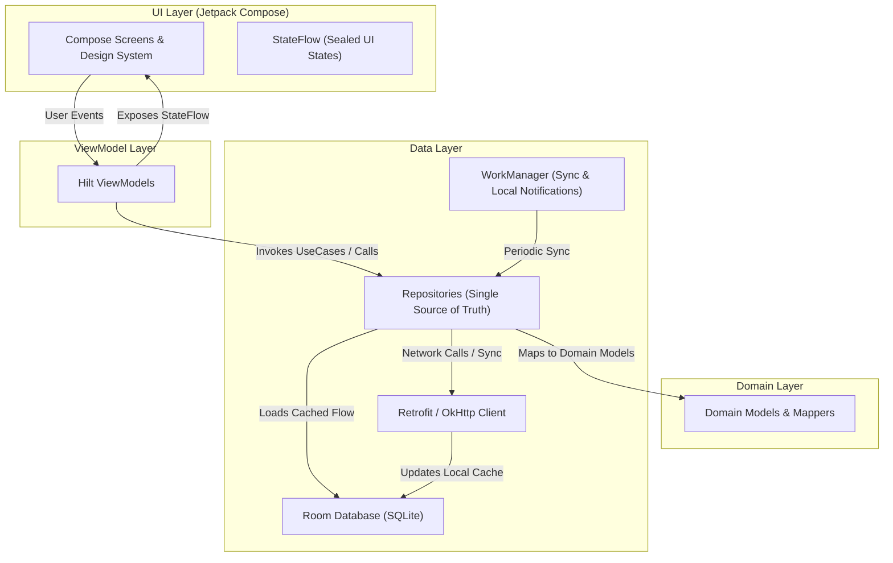

# PeakConnect Android App

PeakConnect is an offline-first Himalayan trekking and outdoor adventure platform for Android. It connects trekkers with certified, knowledgeable local mountain guides, providing trail discovery, matching, offline itinerary access, localized navigation, and payments.

---

## Screenshots

<!-- Add screenshots here: Explore Grid, Activity Detail, Guide Matching, Booking Status, Payment, Guide Dashboard, Offline Mode, Hindi Localization -->
*(Screenshots placeholder: Add your app screenshots showing key flows here)*

---

## Features

- **Trekker Experience**
  - **Activity Discovery**: Browse high-altitude Himalayan treks, river rafting, and camping activities with responsive multi-category filtering, difficulty tags, and price sorting.
  - **Guide Matching**: Smart guide matching algorithm scoring guides by skills, proximity to trailhead, and spoken languages.
  - **Booking & Deposit Checkout**: Seamless booking requests with deposit calculation (20% deposit).
  - **Booking Status & Cancellation**: Interactive stepper timeline tracking request states (`PENDING_GUIDE_RESPONSE`, `AWAITING_PAYMENT`, `CONFIRMED`, `CANCELLED`). Transparent cancellation policy calculator showing exact refund percentages based on days remaining before trek departure.
  - **Add to Calendar & Map Directions**: Export confirmed treks to device calendar apps and open trailhead coordinates in external navigation apps.

- **Guide Experience**
  - **Guide Dashboard**: Dedicated home screen highlighting incoming booking requests with real-time response countdown timers, verified guide status, and quick stats.
  - **Profile Management**: Customize guide skills, spoken languages, experience level, and base location.
  - **Interactive Map Location Picker**: Pick base location coordinates directly on an OpenStreetMap interface with address search suggestions.
  - **Booking Management**: Accept or decline booking requests, view detailed trekker itineraries, and mark trekker no-shows.

- **Offline Mode & Hardening**
  - **Offline-First Architecture**: Powered by Room Database caching all activities, bookings, and user content locally.
  - **Graceful Offline Degrade**: Browse previously loaded treks, inspect booking details, and view packing checklists without network access.
  - **Action Gating**: Interactive actions that require server communication (booking, payments, guide response) are gracefully disabled with helpful contextual messages (`OnlineOnlyButton`).
  - **Auto-Sync on Reconnect**: Seamlessly re-syncs state when connectivity is restored via `NetworkMonitor`.

- **Local Notifications**
  - **Local Notifications**: Automated on-device notifications alerting users about guide response acceptances, payment countdowns, upcoming trek departures, and waitlist promotions.
  - **Background WorkManager**: Periodic background sync workers polling for updates when the app is backgrounded.

- **OpenStreetMap (OSMDroid)**
  - Embedded interactive and non-interactive trail maps powered by OpenStreetMap (`osmdroid`) without external Google Play Services dependencies.

- **Payments in Test Mode**
  - Integrated Razorpay Checkout SDK for processing deposit payments in test mode, supporting simulated cards, UPI IDs, and net banking with signature verification.

- **Hindi Localization**
  - Full dual-language localization (English and Hindi / हिन्दी) across all UI screens, error dialogs, empty states, and system notifications.
  - In-app language switching with instant configuration updates.

---

## Architecture Overview

PeakConnect follows modern Android architecture best practices with **Clean Architecture** and **Unidirectional Data Flow (MVI/MVVM)**:



---

## Tech Stack

| Category | Technology |
|---|---|
| **Language** | Kotlin 2.2.10 |
| **UI Framework** | Jetpack Compose (BOM 2026.02.01), Material 3 Design System |
| **Navigation** | Navigation Compose |
| **Dependency Injection** | Dagger Hilt 2.56 with Hilt Work & Navigation Compose |
| **Asynchronous & Reactive** | Kotlin Coroutines, StateFlow, SharedFlow |
| **Local Database** | AndroidX Room 2.6.1 (with KSP code generation and Paging 3) |
| **Networking & Serialization** | Retrofit 2.11.0, OkHttp 4.12.0, Kotlinx Serialization Json 1.8.0 |
| **Image Loading** | Coil 3.1.0 (with 100MB disk cache and memory cache) |
| **Maps** | OSMDroid (OpenStreetMap) 6.1.20 |
| **Payments** | Razorpay Standard Android Checkout SDK 1.7.20 |
| **Background Tasks** | AndroidX WorkManager 2.10.0 |
| **Testing** | JUnit 4, MockK, Robolectric, Turbine, Compose UI Testing |
| **Build System** | Android Gradle Plugin 9.4.1, Gradle 9.6.0, R8 Minification |

---

## Project Structure

```
frontend/
├── app/
│   ├── src/
│   │   ├── main/
│   │   │   ├── java/com/peakconnect/app/
│   │   │   │   ├── core/                  # Design system, theme, network, preferences, session, util
│   │   │   │   │   ├── images/            # Image manifest & URL resolver
│   │   │   │   │   ├── locale/            # Language & localization manager
│   │   │   │   │   ├── network/           # ApiResult, ErrorMapper, RetryInterceptor, WakeUpRetry
│   │   │   │   │   ├── notifications/     # Local notification channels & poster
│   │   │   │   │   ├── preferences/       # DataStore preference stores
│   │   │   │   │   ├── session/           # TokenStore & SessionManager
│   │   │   │   │   ├── theme/             # Material3 theme, typography, colors, spacing
│   │   │   │   │   └── ui/                # Reusable UI widgets (cards, buttons, chips, topbar, maps)
│   │   │   │   ├── data/                  # Room entities, DAOs, Retrofit API, DTOs, Repositories
│   │   │   │   │   ├── api/               # PeakConnectApi Retrofit interface
│   │   │   │   │   ├── dto/               # Kotlinx serialization request & response DTOs
│   │   │   │   │   ├── local/             # Room Database, DAOs, Entity models
│   │   │   │   │   └── repository/        # Repository implementations (Activity, Auth, Booking, Guide)
│   │   │   │   ├── domain/                # Pure Kotlin domain models, enums & mappers
│   │   │   │   │   └── model/             # Activity, Booking, Guide, Slot, Enum models
│   │   │   │   └── feature/               # Feature screens and ViewModels
│   │   │   │       ├── about/             # App info, open source licenses, feedback
│   │   │   │       ├── auth/              # Login & Registration screens
│   │   │   │       ├── boot/              # Splash & cold-start wake-up polling
│   │   │   │       ├── explore/           # Explore grid, search, filter bottom sheet
│   │   │   │       ├── guide/             # Guide home dashboard, booking details, profile edit, map picker
│   │   │   │       ├── notifications/     # Notifications inbox & settings
│   │   │   │       ├── payment/           # Razorpay checkout bridge & payment result
│   │   │   │       ├── profile/           # User profile & settings dialogs
│   │   │   │       ├── safety/            # Safety tips & emergency 112 caller
│   │   │   │       └── trekker/           # Activity detail, guide matches, booking review, status tracking
│   │   │   └── res/
│   │   │       ├── values/                # English strings, colors, styles, themes
│   │   │       ├── values-hi/             # Hindi localized strings
│   │   │       └── xml/                   # Locales config, network security config
│   │   ├── test/                          # Unit tests & Robolectric Compose UI tests (300 tests)
│   │   └── androidTest/                   # Instrumented Android device tests
│   ├── proguard-rules.pro                 # R8 keep rules (Kotlinx Serialization, Retrofit, Room, Razorpay)
│   └── build.gradle.kts                   # App module build configuration
├── docs/                                  # API contract, Design system, Progress log, Demo script
├── local.properties.example               # Template for configuration keys
└── README.md                              # This document
```

---

## How to Build and Run

### Prerequisites
- **JDK 17** installed and configured.
- **Android Studio** (Ladybug, Meerkat, or newer).
- **Android SDK** API 37 installed (minimum supported Android version: Android 8.0, API 26).

### Setup Steps
1. **Clone the repository:**
   ```bash
   git clone https://github.com/YadavKshitiz/peak-connect_backend.git
   cd peakConnect/frontend
   ```
2. **Configure `local.properties`:**
   Copy the example template file:
   ```bash
   cp local.properties.example local.properties
   ```
   Open `local.properties` and provide your configuration:
   ```properties
   sdk.dir=/path/to/your/Android/Sdk
   API_BASE_URL=https://peak-connect-backend.onrender.com/
   RAZORPAY_KEY_ID=rzp_test_YOUR_KEY_HERE
   ```
   *(Note: Never commit `local.properties` to version control).*

3. **Build the Debug APK:**
   ```bash
   ./gradlew assembleDebug
   ```

4. **Run Unit & UI Tests:**
   ```bash
   ./gradlew testDebugUnitTest
   ```

5. **Build the Minified Release APK:**
   ```bash
   ./gradlew assembleRelease
   ```
   The release APK will be generated at `app/build/outputs/apk/release/app-release.apk`.
   *(If `RELEASE_*` signing properties are not provided in `local.properties`, the build safely falls back to the debug keystore for development convenience).*

---

## How the Image Manifest Works

PeakConnect dynamically resolves activity hero images without hardcoding images into the APK:

1. **Folder Layout**:
   All activity images are hosted on GitHub in `assets/activity_images/` with normalized JPEG files (e.g., `hampta-pass-trek.jpg`, `triund-trek.jpg`, `beas-kund-trek.jpg`).
2. **Manifest File (`manifest.json`)**:
   Located at `assets/activity_images/manifest.json`, the manifest specifies:
   - `baseUrl`: The base GitHub raw URL.
   - `defaults`: Category fallback images for `"rafting"`, `"trekking"`, `"camping"`, `"hiking"`.
   - `items`: Exact activity mappings containing `"title"`, `"location"`, and relative `"image"` path.
3. **Resolution & Fallback Order**:
   - Exact Title + Location match.
   - Title substring match.
   - Category keyword fallback match (`raft` → rafting default, `trek` → trekking default, etc.).
   - If offline or unresolvable, a styled gradient placeholder fallback box (`ImageFallbackBox`) is displayed with mountain topography icons.
4. **Offline Caching**:
   `ImageManifestRepository` bundles a fallback `manifest.json` in APK assets, checks for a locally cached manifest in `filesDir`, and asynchronously refreshes the remote manifest on startup without blocking UI rendering.

---

## How Local Notifications Work & Limitations

- **Engine**: PeakConnect uses Android's native `NotificationManager` and `WorkManager` for **local notifications**.
- **Important**: The app relies entirely on **local notifications**; it does **not** use remote push notification services (such as Firebase Cloud Messaging).
- **Background Sync**:
  - `NotificationWorkScheduler` registers a periodic `PeriodicWorkRequest` running every ~15 minutes (the WorkManager minimum interval).
  - When new updates arrive (such as guide acceptance or cancellation), `LocalNotificationPoster` triggers high-priority heads-up local notifications.
- **Notification Limits**:
  - Local notifications may be delayed by up to ~15 minutes or longer when Android battery saver or aggressive Doze mode optimizations are active.
  - Background polling stops approximately 24 hours after the app was last opened because the JWT login token expires and the backend does not provide a refresh token endpoint.

---

## Known Limitations

- **Server Cold Starts on Free Tier**: The backend is hosted on a Render free-tier instance that spins down when idle. The first request after inactivity can take 30–60 seconds to wake up the server.
- **Local Notification Delay**: Because background updates use WorkManager periodic polling, local notifications may be delayed up to ~15 minutes (or longer under aggressive OS battery optimizations).
- **Session Expiry**: Login tokens expire after 24 hours without a refresh token endpoint. Re-login is required after 24 hours to resume authenticated actions.
- **Waitlist Device-Local Tracking**: Waitlist entries are stored in the device's Room database because the backend lacks a dedicated `GET /api/bookings/waitlist` endpoint.
- **Approximate Countdowns**: Response and payment timers are calculated based on client clock relative to server creation timestamps.
- **Admin Role Not in App**: Admin management tasks are handled via the web backend admin panel; only Trekker and Guide roles are supported in the mobile application.
- **Server Data Stays in English**: While all UI labels, navigation, and error messages are fully translated into Hindi, user-generated trek titles and descriptions stored on the server remain in English.

---

> [!TIP]
> **Demo tip: open the app once before a demo to wake the server.**
> Because the backend is hosted on Render's free tier, opening the app a couple of minutes prior to a live presentation ensures the backend instance is warm and responds instantly.

